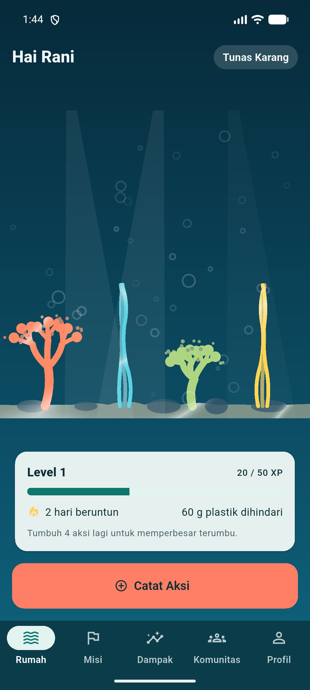
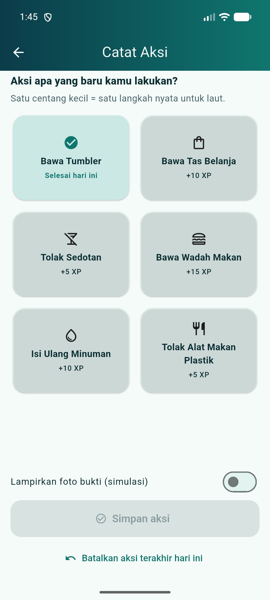
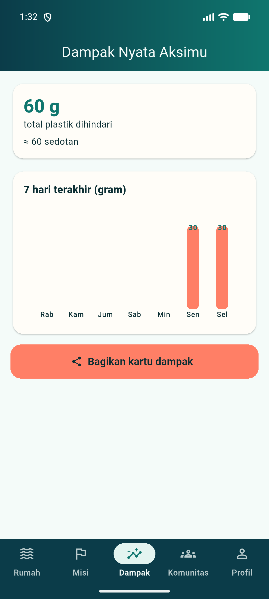
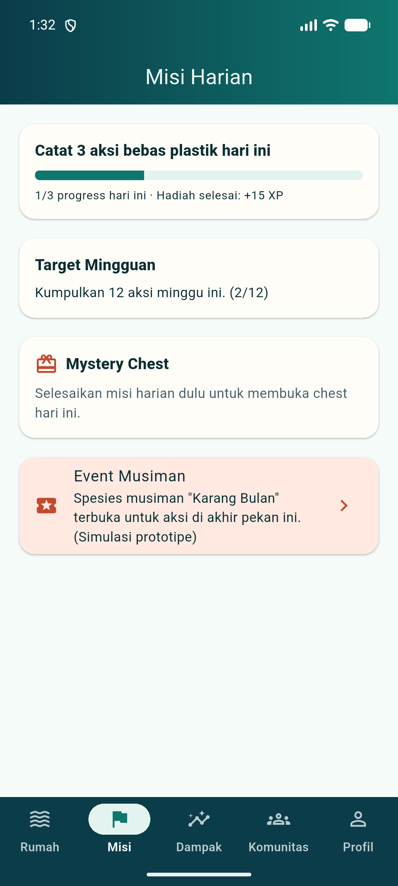
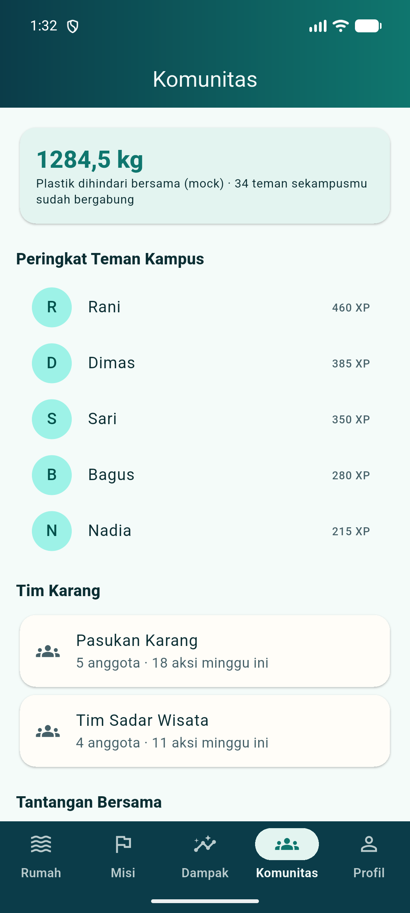
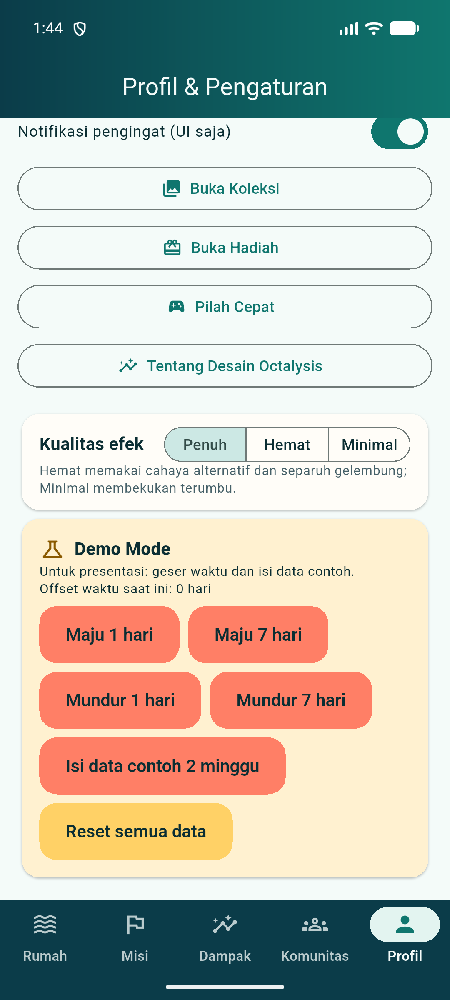
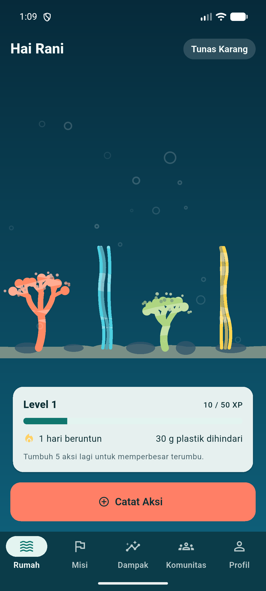
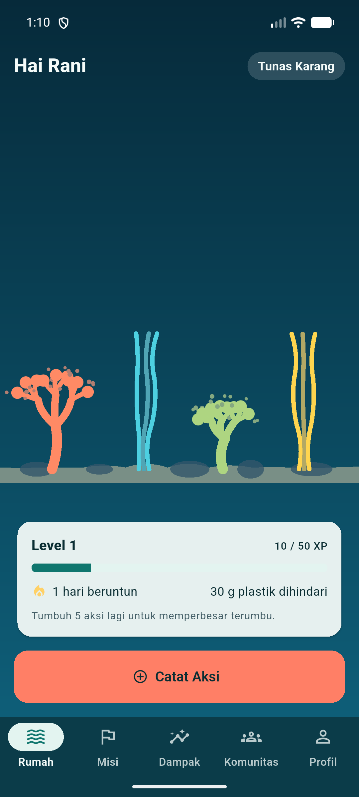

# Terumbu Kita

Prototipe aplikasi gamifikasi (Flutter) untuk mengurangi plastik sekali pakai,
dibangun dengan kerangka kerja **Octalysis** (Chieu-Kuang Lee, 8 Core Drives).
Ini adalah proyek tugas akhir mata kuliah Gamifikasi.

Setiap aksi nyata (membawa tumbler, menolak sedotan, ...) membuat terumbu karang
virtualmu tumbuh — dari *Tunas Karang* sampai *Ekosistem*. Mekanik game, angka,
dan aturan dirancang di [spec.md](spec.md); proses kerjanya di [agent.md](agent.md).

## Galeri

| Rumah (terumbu hidup) | Catat Aksi | Dampak Nyata |
|---|---|---|
|  |  |  |

| Misi | Komunitas | Profil & Pengaturan |
|---|---|---|
|  |  |  |

## Fitur utama

- **Terumbu karang prosedural yang hidup** — digambar penuh dengan
  `CustomPainter` + fragment shader (caustics), tanpa aset gambar eksternal.
  Karang bertambah dan berubah spesies seiring progres; warna memudar saat
  "health" terumbu turun (bleaching) sebagai umpan balik.
- **Aksi & hadiah instan** — 6 jenis aksi bebas plastik, XP, streak harian,
  konversi ke gram plastik yang dihindari, dan kartu dampak (fl_chart).
- **Misi harian, target mingguan, mystery chest, dan event musiman**
  (simulasi prototipe) sesuai rotasi quest di spec.
- **Komunitas & koleksi** — papan komunitas simulasi, koleksi spesies karang,
  hadiah, dan mini-game.
- **Pengaturan kualitas grafis** (Penuh / Hemat / Minimal) — lihat di bawah.
- **Demo Mode** di Profil untuk presentasi: geser waktu ±1/±7 hari dan isi
  data contoh 2 minggu, plus reset semua data.
- Semua teks antarmuka Bahasa Indonesia, terpusat di
  `lib/core/constants/app_strings.dart`.

## Octalysis

Delapan Core Drive dipetakan satu per satu ke mekanik (detail lengkap dan
alasan desain ada di [docs/octalysis_mapping.md](docs/octalysis_mapping.md)):

| Core Drive | Contoh mekanik di aplikasi |
|---|---|
| 1. Epic Meaning & Calling | Narasi menyelamatkan laut, dampak nyata dalam gram |
| 2. Accomplishment | XP, level, streak, koleksi spesies karang |
| 3. Empowerment of Creativity | Terumbu yang tumbuh dan bereaksi tiap aksi |
| 4. Ownership | Terumbu adalah "milik" pengguna; health bisa menurun |
| 5. Social Influence | Papan komunitas, kartu dampak yang bisa dibagikan |
| 6. Scarcity & Impatience | Misi harian, event musiman terbatas |
| 7. Unpredictability & Curiosity | Mystery Chest, spesies musiman misterius |
| 8. Loss & Avoidance | Bleaching terumbu saat health turun (nada ajakan, bukan ancaman) |

## Kualitas efek grafis

Di **Profil → Kualitas efek** ada tiga mode; pilihan tersimpan lokal
(`shared_preferences`), langsung berlaku tanpa restart, dan tidak mereset progres.
Jika perangkat mematikan animasi sistem (`disableAnimations`), aplikasi memaksa
mode Minimal dan menampilkannya sebagai catatan kecil.

| Penuh | Hemat | Minimal |
|---|---|---|
|  |  |  |
| Shader caustics, 36 gelembung parallax 3 lapis, berkas cahaya sampai dasar, kilatan naik level | Caustics fallback (pita cahaya ter-clip presisi ke bentuk karang & pasir), separuh gelembung, tanpa berkas cahaya | Terumbu beku; animasi hanya feedback singkat saat aksi dicatat |

Semua angka efek (jumlah gelembung, durasi, dsb.) terpusat di
`lib/core/constants/visual_config.dart`. Jika shader gagal dimuat, mode Penuh
otomatis jatuh ke gaya Hemat tanpa mengubah pilihan tersimpan.

## Teknologi

- Flutter 3.x (Dart SDK ^3.14), target Android
- `flutter_riverpod` 3.x — state management
- `go_router` — shell navigation (StatefulShellRoute + IndexedStack)
- `shared_preferences` — persistensi lokal (progres, pengaturan)
- `fl_chart` — grafik dampak
- Fragment shader GLSL (`assets/shaders/caustics.frag`) untuk caustics
- Tanpa backend; seluruh data simulasi prototipe

## Menjalankan

```bash
flutter pub get
flutter run -d <device-id>
```

Pratinjau shader butuh perangkat/emulator dengan dukungan GPU. Untuk mengukur
FPS nyata (belum terverifikasi di emulator), jalankan profile mode di HP asli:

```bash
flutter run --profile -d <device-id>
```

lalu aktifkan PerfOverlay untuk membandingkan mode Penuh dan Hemat.

## Testing

```bash
flutter test      # unit + widget test (mekanik game, penyimpanan, mode grafis)
flutter analyze   # nol error
```

Test mencakup aturan XP/streak/health, persistensi pengaturan kualitas, dan
pemetaan mode ke konfigurasi efek.

## Struktur proyek

```
lib/
  app.dart               # router & konfigurasi aplikasi
  core/
    constants/           # game_rules, app_strings, visual_config
    theme/               # palet & tema (dua varian)
    utils/               # logika murni (game_logic, formatters)
    providers.dart       # Riverpod providers
  data/                  # model + repository (shared_preferences)
  features/              # home, actions, quests, impact, community,
                         # profile, collection, rewards, minigame,
                         # octalysis, onboarding
  shared/widgets/        # reef_scene, reef_painter, app_shell, sea_app_bar
assets/shaders/          # caustics.frag
test/                    # unit & widget test
docs/                    # pemetaan Octalysis + screenshot
```

## Dokumentasi

- [spec.md](spec.md) — spesifikasi mekanisme, layar, dan aturan angka
- [agent.md](agent.md) — alur kerja, konvensi commit, dan aturan QA
- [docs/octalysis_mapping.md](docs/octalysis_mapping.md) — pemetaan 8 Core Drive

## Catatan

Prototipe kelas: tidak ada server, foto bukti disimulasikan, dan data komunitas
adalah contoh statis. Angka konversi plastik (gram per aksi) adalah estimasi
untuk keperluan demonstrasi.
